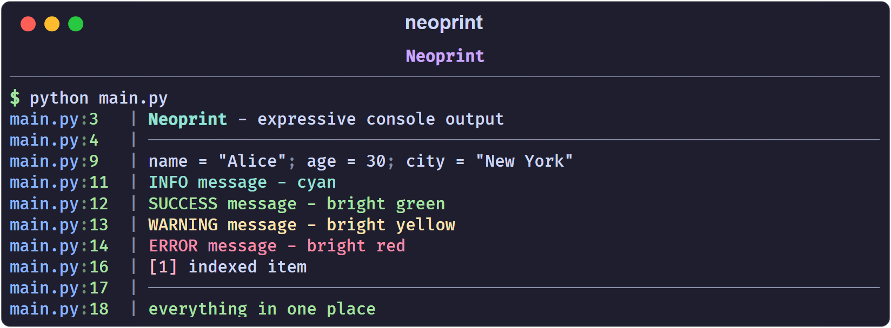
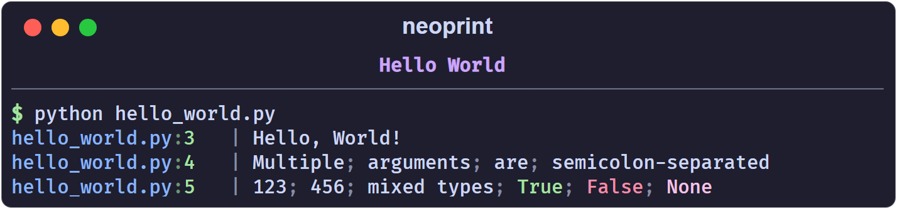
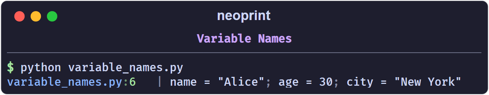
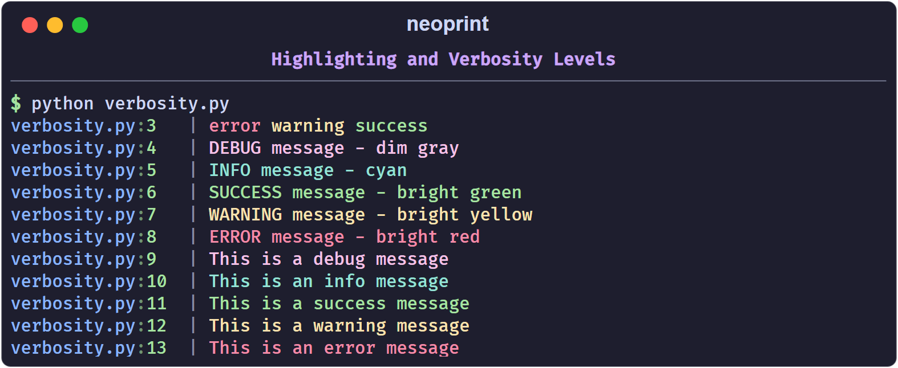
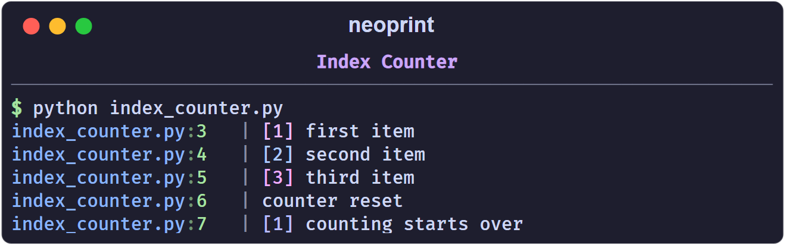
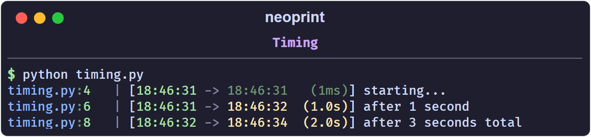
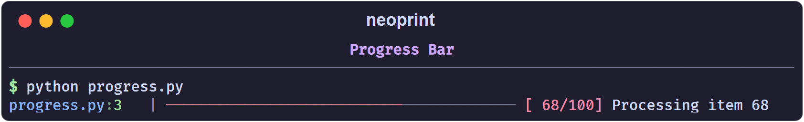
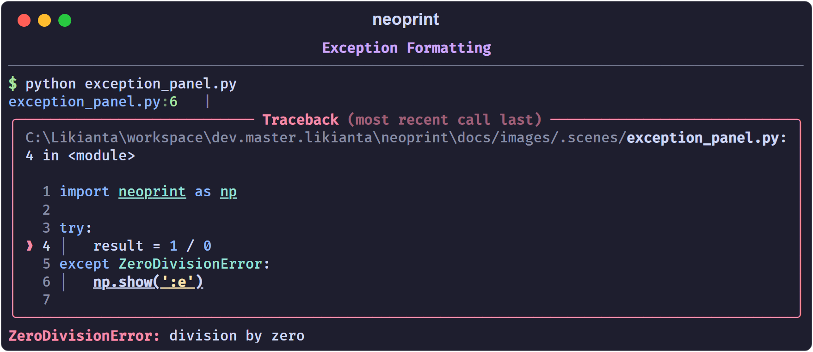
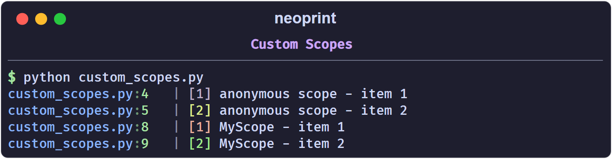
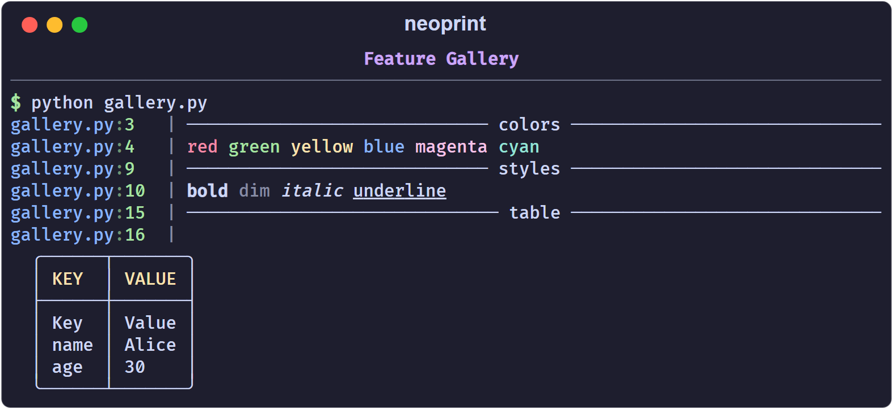

# Neoprint

[](https://badge.fury.io/py/neoprint)
[](https://pepy.tech/project/neoprint)
[](https://pepy.tech/project/neoprint)

A powerful alternative to Python's built-in `print` function with rich features for console output.



## Features

- **Colored output** with BBCode-style markup (`[red]text[/]`, `[bold]text[/]`, etc.)
- **Variable names** auto-detection (`:n` markup)
- **Verbosity levels** for different message types (debug, info, success, warning, error)
- **Index counters** for tracking sequences (`:i` markup)
- **Timestamp support** for timing operations (`:t` markup)
- **Progress bars** for long-running operations
- **Pretty exception formatting** with Rich library integration
- **Source location** display for easier debugging

## Installation

```sh
pip install neoprint
```

Requires Python 3.9 and above.

## Quick Start

### Hello World

```python
import neoprint as np

np.show('Hello, World!')
np.show('Multiple', 'arguments', 'are', 'semicolon-separated')
np.show(123, 456, 'mixed types', True, False, None)
```



### Print with Variable Names

```python
import neoprint as np

name = 'Alice'
age = 30
city = 'New York'
np.show(name, age, city, ':n')
```



### Highlighting and Verbosity Levels

```python
import neoprint as np

# Basic text highlighting with BBCode
np.show('[red]error[/] [yellow]warning[/] [green]success[/]', ':r')

# Verbosity levels (:v0 to :v8)
np.show(':v1', 'DEBUG message - dim gray')
np.show(':v2', 'INFO message - cyan')
np.show(':v4', 'SUCCESS message - bright green')
np.show(':v6', 'WARNING message - bright yellow')
np.show(':v8', 'ERROR message - bright red')

# Using shorthand functions
np.debug('This is a debug message')
np.info('This is an info message')
np.success('This is a success message')
np.warning('This is a warning message')
np.error('This is an error message')
```



### Indexing

```python
import neoprint as np

np.show(':i2', 'first item')
np.show(':i2', 'second item')
np.show(':i2', 'third item')
np.show(':i0', 'counter reset')
np.show(':i2', 'counting starts over')
```



### Timing

```python
import neoprint as np
from time import sleep

np.show(':t', 'starting...')
sleep(1)
np.show(':t', 'after 1 second')
sleep(2)
np.show(':t', 'after 3 seconds total')
```



### Progress Bars

```python
import neoprint as np
from time import sleep

# Basic progress bar
with np.Progress(total=100) as prog:
    for i in range(100):
        prog.update(f'Processing item {i + 1}')
        sleep(0.03)

# Simple iteration wrapper
items = range(50)
for item in np.progress(items):
    sleep(0.05)
```



### Exception Formatting

```python
import neoprint as np

try:
    result = 1 / 0
except ZeroDivisionError:
    np.show(':e')
```



### Custom Scopes

```python
import neoprint as np

with np.scope():
    np.show(':i2', 'anonymous scope - item 1')
    np.show(':i2', 'anonymous scope - item 2')

with np.scope(name='MyScope'):
    np.show(':i2', 'MyScope - item 1')
    np.show(':i2', 'MyScope - item 2')
```



## Markup Reference

Markups are short codes starting with `:` that modify the output behavior. They can be placed as the first or last argument.

| Mark | Description |
| :--- | :---------- |
| `:d` | Divider line |
| `:e` | Exception formatting |
| `:i` | Auto-increment index |
| `:l` | Long/expanded format (multiple lines) |
| `:n` | Show variable names |
| `:r` | Rich text/BBCode rendering |
| `:t` | Timestamp/timing |
| `:v` | Verbosity level (`:v0` to `:v8`) |

**Common options:**

- `:d1` - thin divider, `:d2` - thick divider
- `:e1` - simple exception, `:e2` - pretty exception (default)
- `:i0` - reset all counters
- `:l1` - expanded format, `:l2` - special expanded (tables)
- `:n0` - hide varnames, `:n1` - show varnames (default)
- `:r0` - disable rich, `:r1` - enable rich (default)
- `:v0` - trace, `:v1` - debug, `:v2` - info, `:v4` - success, `:v6` - warning, `:v8` - error

For more advanced markups and detailed documentation, see [markup_list.md](docs/mdbook.zh/src/markup_list.md).

## BBCode Color Reference

```python
np.show('[black]black[/]', ':r')
np.show('[red]red[/]', ':r')
np.show('[green]green[/]', ':r')
np.show('[yellow]yellow[/]', ':r')
np.show('[blue]blue[/]', ':r')
np.show('[magenta]magenta[/]', ':r')
np.show('[cyan]cyan[/]', ':r')
np.show('[white]white[/]', ':r')
```

Bright variants: `bright_red`, `bright_green`, etc.

Styles: `bold`, `dim`, `italic`, `underline`

```python
np.show('[red bold]red bold[/]')
np.show('[blue italic]blue italic[/]')
np.show('[green underline]green underline[/]')
```

## Screenshots



---

For more examples, see the [examples](examples/) directory.
