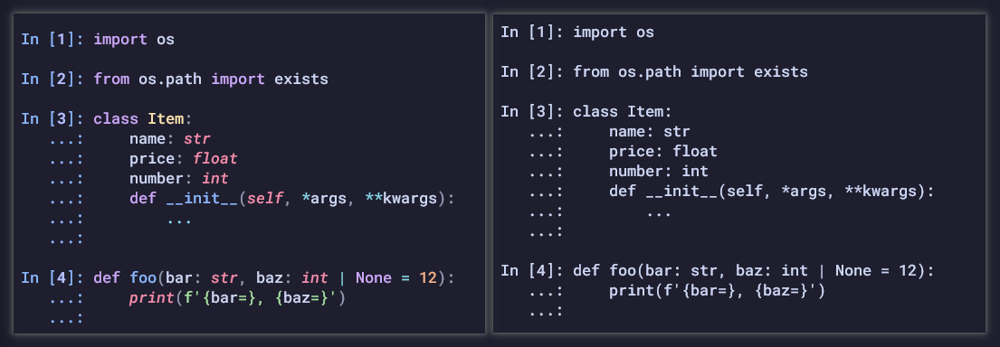
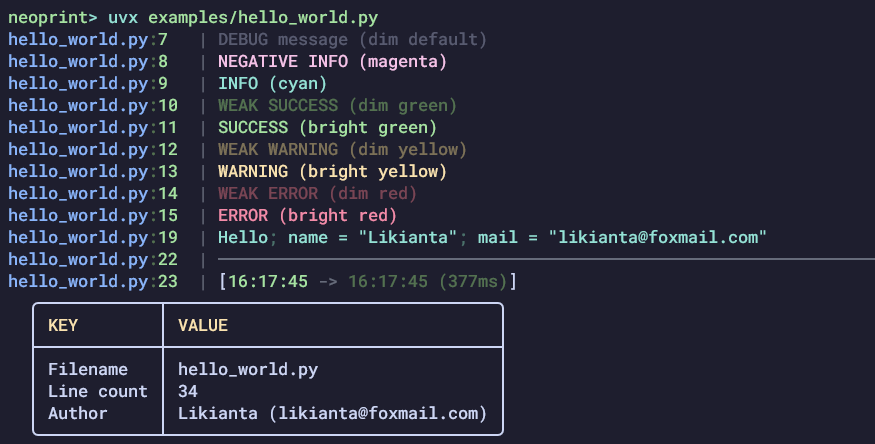

# 你是否需要一个更好的 Python 打印 -- Neoprint 库

现代化的终端给了控制台输出更多渲染特性: 从连字符号, 真彩文字, 到动态效果. 这些都在提升程序开发者的体验, 总的来说, 这是一种前卫且愉悦的视觉体验.

因此, 颜色是控制台输出的重要的组成部分. 以 IPython 为例, 有语法高亮和没有高亮的感受是不一样的:



而一个美观且合理的信息输出同样重要, 试想我们只需要最简单的打印方法, 就能清楚地看到信息来源, 文字排版, 对象结构长什么样:




**[Neoprint](https://github.com/likianta/neoprint)** 库为此而设计, 它可以作为 python print 的平替 (几乎相同的 API), 并在现代终端中输出色彩丰富且结构经过重新排版的信息.

## 如何使用

首先 pip 安装:

```sh
pip install neoprint
```

支持 Python 3.9 及以上版本. 它的依赖很轻, 只有 rich 一个.

你可以在单个脚本里导入并使用:

```python
from neoprint import print
print('hello world')
```

如果想在多个文件都能生效, 且省去每次都要导入的话:

```python
# in your some_package/__init__.py, write this:
import neoprint
neoprint.setup()

# then the regular exports
from .foo import bar
...
```

这样, some_package/ 目录下的所有模块的 `print` 语句都会生效.

## 了解更多

Neoprint 是一个开源项目, 你可以在 GitHub 中找到它: https://github.com/likianta/neoprint.

完整的文档点此访问: https://likianta.github.io/neoprint/
