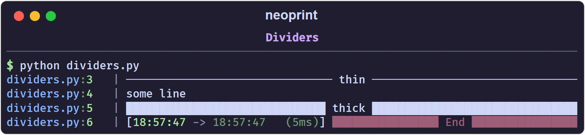

# Dividers

The `d` mark frames a message with a horizontal rule. It is a lightweight way
to separate sections in a long run of output.

```python
import neoprint as np

np.show(':d', 'Section title')
np.show('some line')
np.show('another line')
```

```text
main.py:3   | ──────────────────── Section title ─────────────────────
main.py:4   | some line
main.py:5   | another line
```

The rule spans the console width; the text you passed sits in the middle.

## Variants

| Mark | Look |
| :--- | :--- |
| `:d1` | thin line (bare `:d`) |
| `:d2` | thick block line |

```python
np.show(':d1', 'thin')
np.show(':d2', 'thick')
```



## Interaction with other marks

- `:d` cannot be combined with `:l` — a divider needs a single-line body.
  Combining them raises an `AssertionError`; see
  [How Markup Works](../markup_system.md).
- `:d` turns `:r2` off, because `:r2` produces multi-line layouts too.
- Any other mark, such as `:v8` or `:i`, still applies:
  `np.show(':d2v7t', 'End')` yields a thick divider with a timestamp,
  rendered in the `v7` (dim red) style.

## Shorthand

```python
from neoprint import divider

divider('Section title')
```
