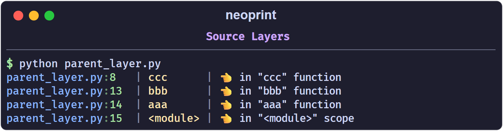

# Source Layers

Every message starts with a head like `main.py:10`. By default that head points
at the line that called `np.show`. The `p` mark moves the head up the call
stack, so a shared logging helper can report the place that *used* it.

## The stack

`p0` is the frame of the `np.show` call itself, `p1` is its caller, `p2` its
caller's caller, and so on. Bare `:p` is `:p1`.

```python
import neoprint as np            # ln1

def aaa():                       # ln3
    def bbb():                   # ln4
        def ccc():               # ln5
            np.show('DDD', ':p0')    # ln7
            np.show('CCC', ':p1')    # ln8
            np.show('BBB', ':p2')    # ln9
            np.show('AAA', ':p3')    # ln10
        ccc()                    # ln12
    bbb()                        # ln13
aaa()                            # ln14
```



`p0` reports the line that printed; `p1` reports the line that called that
function; and so on. Going further than the stack depth raises an error, so
the practical range is `p0` to `p3`.

## Why it matters

Consider a library method that is called from many places. With `:p`, each
message points at the *caller*, not at the library:

```python
import neoprint as np

class Library:
    def borrow_book(self, book_name):
        np.show('borrowed "{}"'.format(book_name), ':p')
        return Book(book_name)

lib = Library()

# in aaa.py
lib.borrow_book('Stray Birds')

# in bbb.py
lib.borrow_book('How the Steel Was Tempered')
```

```text
aaa.py:8    | borrowed "Stray Birds"
bbb.py:10   | borrowed "How the Steel Was Tempered"
```

That is how you trace which script triggered a shared code path.

## Temporarily elevate stack pointer

Use `np.elevate_parent_level` to redirect `:p<n>` to n+1 place:

```python
import neoprint as np
from random import choice

def source_test():
    if choice((True, False)):
        print('Server is working fine', ':pv4')
    else:
        print('Server is unavailable for now', ':pv8')

def proxy_test():
    with np.elevate_parent_level():
        source_test()

# by client a
source_test()

...

# by client b
proxy_test()
```

The proxy hides itself and reveals print header points to the position of 
client b.

## Relationship with varnames

`:p` only moves the *head* (the source prefix). Variable names from `:n` are
always read from the line where `np.show` is written, regardless of `:p`. In a
shared helper, the values passed to the helper still come from the helper's own
line, while the head shows the outside caller.

Note that `p2` and above rely on the interpreter's stack being intact. Inside
heavy wrappers or asynchronous code, prefer `:p1`.
