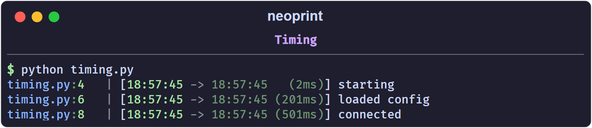

# Timing

The `t` mark appends a timestamp to the message. It is useful for tracing how
long stages take without exporting metrics.

```python
from time import sleep
import neoprint as np

np.show(':t', 'starting')
sleep(0.2)
np.show(':t', 'loaded config')
sleep(0.5)
np.show(':t', 'connected')
```



The prefix shows the previous timestamp, the current one, and the delta.
Formatting scales automatically: milliseconds for short gaps, seconds,
minutes, hours for long ones.

## The four variants

| Mark | Means |
| :--- | :---- |
| `:t1` | absolute timestamp only, no delta |
| `:t2` | time since the previous `:t2`/`:t3` call (bare `:t`) |
| `:t3` | time since the scope timer started, or since `:t0` |
| `:t0` | reset the timer |

`:t2` and `:t3` share one "instant" pointer, so alternating them measures each
step against the previous call. `:t0` moves that pointer to now and restarts
the current scope's timer.

## Scopes

Inside `np.scope()`, `:t3` measures from the moment the scope was entered:

```python
with np.scope(name='job'):
    np.show(':t3', 'start')
    sleep(1)
    np.show(':t3', 'one second into the job')
```

Outside a scope, `:t3` measures from the most recent `:t0`.

## Practical pattern

`:t` is most useful as a drop-in replacement for ad-hoc
`time.perf_counter()` logging:

```python
np.show(':t', 'begin download')
data = download()
np.show(':t', 'downloaded {} bytes'.format(len(data)))
np.show(':t', 'done')
```
