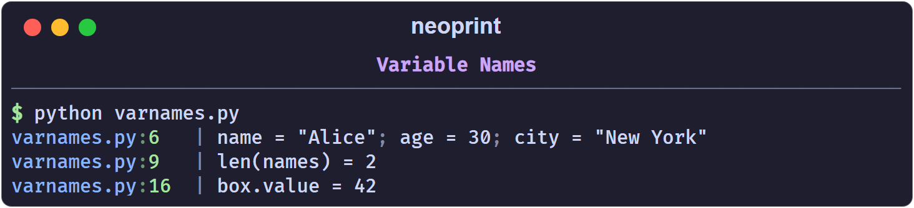

# Variable Names

The `n` mark prints each argument next to its source expression. Neoprint reads
the source line you called it from, so you never have to type `'name ='`
yourself.

```python
import neoprint as np

name = 'Alice'
age = 30
city = 'New York'
np.show(name, age, city, ':n')
```

```text
main.py:6   | name = "Alice"; age = 30; city = "New York"
```

## Expressions work too

Plain names are only the beginning. Function calls and attribute accesses are
also reconstructed:

```python
names = ['Alice', 'Bob']
np.show(len(names), ':n')
```

```python
class Box:
    def __init__(self):
        self.value = 42

box = Box()
np.show(box.value, ':n')
```



## Enable it globally

If you want variable names on every call without repeating the mark, turn on
the configuration switch:

```python
import neoprint as np

np.config(show_varnames=True)

name = 'Alice'
np.show(name)       # name = "Alice"
```

Restore the default with `np.config(show_varnames=False)` or
`np.config.reset()`.

## Limitations

- **The function has to keep a recognizable name.** Neoprint only inspects
  calls to `print`, `show`, `debug`, `info`, `success`, `warning`, `error`,
  `format`, and `format_list`. If you alias the import, for example
  `from neoprint import show as s`, the call no longer looks like one of those
  names and the mark cannot resolve the arguments. Use
  `from neoprint import print` (the name is `print`) instead of renaming.
- **Literals have no name.** `np.show(42, ':n')` prints `42`, because there is
  nothing to reflect.
- **Truthiness of the mark.** `:n0` hides names, `:n1` (bare `:n`) shows them.

## How it works, briefly

The source file of the calling frame is parsed with `ast` and cached per
modification time. The analyzer finds the `Call` node on the reported line and
reads the source segment of each argument. That is why the names are exactly
what you wrote — including spacing inside longer expressions — and why the
feature costs one file parse per source change, not per call.

See also [Source Layers](./parent_layer.md) for how the head of a message is
resolved.
