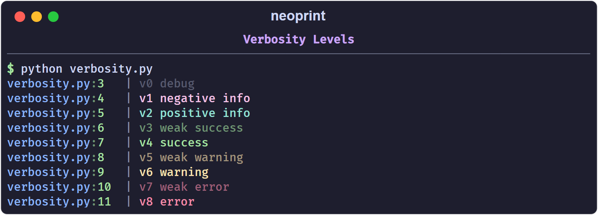

# Verbosity Levels

The `v` mark colors a message according to its severity. The scale runs from
`v0` (debug) to `v8` (error); odd numbers are dim variants of the even one
above them.

```python
import neoprint as np

np.show(':v0', 'v0 debug')
np.show(':v1', 'v1 negative info')
np.show(':v2', 'v2 positive info')
np.show(':v3', 'v3 weak success')
np.show(':v4', 'v4 success')
np.show(':v5', 'v5 weak warning')
np.show(':v6', 'v6 warning')
np.show(':v7', 'v7 weak error')
np.show(':v8', 'v8 error')
```

| Level | Meaning | Color |
| :---- | :------ | :---- |
| `v0` | debug | gray |
| `v1` | negative or serious info | magenta |
| `v2` | positive or neutral info | blue |
| `v3` | weak success | dim green |
| `v4` | success | green |
| `v5` | weak warning | dim yellow |
| `v6` | warning | yellow |
| `v7` | weak error / failure | dim red |
| `v8` | error / failure | red |



The color covers the whole body of the message, not the source head.

## Shorthand functions

For the levels you use most, import the ready-made helpers:

```python
from neoprint import debug, info, success, warning, error

debug('user has come here')
info('welcome to the city')
success('file created')
warning('target file exists, will overwrite it')
error('failed to create the file')
```

Each helper is just a call with the matching mark already applied, so marks can
still be appended:

```python
error('failed: {}'.format(err), ':d')   # red message wrapped by dividers
```

The helpers are `functools.partial` objects, not separate implementations, so
they accept the same arguments as `np.show`.

## Choosing a level

A useful rule of thumb:

- `v0`/`v1` for traces you read while developing;
- `v2`/`v4` for confirmations the user of your program cares about;
- `v6` for recoverable surprises;
- `v8` for failures that stop the current task.

If you only need *colored* text and not a semantic level, prefer inline markup
in `:r1` mode — see [Rich Text](./rich_text.md).
