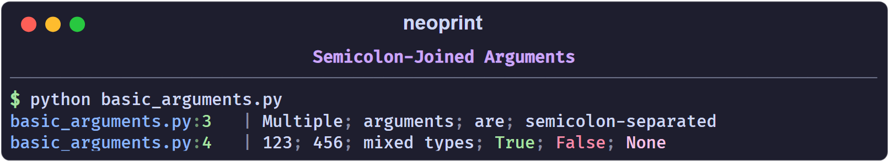

# Printing Basics

## Arguments are joined with semicolons

Multiple positional arguments are printed one after another, separated by a
dim `; ` and a space:

```python
import neoprint as np

np.show('Multiple', 'arguments', 'are', 'semicolon-separated')
np.show(123, 456, 'mixed types', True, False, None)
```

```text
main.py:3   | Multiple; arguments; are; semicolon-separated
main.py:4   | 123; 456; mixed types; True; False; None
```



Booleans are highlighted: `True` is green, `False` is red, `None` is magenta.

If you want a different join style, pass `:l` (one value per line, see
[Expanded Formatting](./guides/expanded_format.md)) or format the string
yourself and pass a single argument.

## Where to put a markup

A *markup* is a short string such as `':n'`, `':v8'` or `':d2v7t'` that
changes how the message is rendered. Each character in it enables one feature;
an optional digit selects a variant.

A markup is recognized in exactly two positions:

1. as the **first** positional argument,
2. as the **last** positional argument.

```python
np.show(':d', 'Section title')          # first
np.show('Section title', ':d')          # last
np.show('Section title', markup=':d')   # keyword
```

Anything else is treated as ordinary text:

```python
np.show('a', ':n', 'b')   # ':n' is printed literally
```

```text
main.py:1   | a; :n; b
```

The string must look like a markup to be treated as one: it has to start with
`:` and contain only the known mark letters. Something like `':)'` or
`': not a markup'` is plain text.

## Combining marks

Marks can be stacked in a single string. Each mark letter may carry at most one
digit:

```python
np.show(':d2v7t', 'End')
```

```text
main.py:1   | [16:57:41 -> 16:57:41 (4ms)] ██████████ End ██████████
```

Read it as `:d2` + `:v7` + `:t`. Order does not matter.

## Bare marks and their defaults

Writing a mark without a digit selects its default variant. For example `:i`
is `:i1` and `:e` is `:e2`:

| Mark | Bare form means |
| :--- | :-------------- |
| `:d` | `:d1` thin divider |
| `:e` | `:e2` traceback panel |
| `:i` | `:i1` line-level counter |
| `:l` | `:l1` expanded format |
| `:n` | `:n1` show variable names |
| `:p` | `:p1` parent frame |
| `:r` | `:r1` inline markup enabled |
| `:s` | `:s1` short form |
| `:t` | `:t2` time since last mark |
| `:v` | `:v0` debug level |

The full list is in [Markup Reference](./markup_reference.md).

## Quiet and plain modes

Two marks reduce or remove neoprint's decoration:

- `:s1` keeps colors but drops the source head and variable names.
- `:s2` hands the arguments to the built-in `print` untouched.

```python
np.show(':s1', 'no source, no varnames')
np.show(':s2', 'built-in print behaviour')
```

```text
no source, no varnames
built-in print behaviour
```

`:s2` is handy when a call must accept the same keyword arguments as the
built-in `print` (for example `file=sys.stderr`).

## A note on string formatting

Neoprint follows the convention of this project: prefer `str.format` over
f-strings, because f-strings in log calls are evaluated even when the output
is filtered by verbosity.

```python
np.show(':v1', 'loaded {} items'.format(count))
```

Next: [How Markup Works](./markup_system.md).
