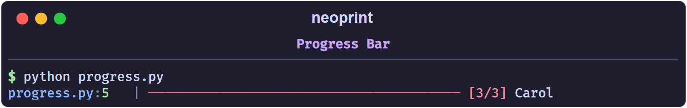
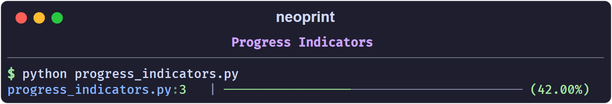

# Progress Bars

Neoprint ships two forms of progress display: an object you drive manually
(`np.Progress`) and a generator you wrap around an iterable (`np.progress`).

## `np.Progress`

```python
from time import sleep
import neoprint as np

names = ['Alice', 'Bob', 'Carol']

with np.Progress(total=len(names)) as prog:
    for name in names:
        prog.update(name)
        sleep(0.05)
```

```text
main.py:6   | ──────────────────────── [  3/3] Carol
```



The bar fills with `─`, the counter shows `index/total`, and `update(label)`
prints a label on the right, truncated to the remaining width. The head
(`main.py:6`) comes from the `with` line.

### `total` is required

`update()` decides the bar type on its first call. If `total` is still `None`
at that point, neoprint raises `NotImplementedError` — the spinner-style
indeterminate bar is not implemented yet. Set `total` either in the constructor
or as a property before the first `update()`:

```python
with np.Progress() as prog:
    prog.total = len(items)
    for item in items:
        prog.update()
```

Setting `total` after the first `update()` raises `ValueError`.

### Indicators

`indicator_style` selects the read-out:

| Style | Example |
| :---- | :------ |
| `'counter'` (default) | `[ 42/100]` |
| `'digital'` | `( 42%)` |
| `'decimal'` | `( 42.00%)` |
| `'none'` | bar only |

`color` accepts `'red'` (default), `'green'`, `'yellow'`, or `'blue'`.

```python
with np.Progress(total=100, indicator_style='decimal', color='green') as p:
    ...
```



## `np.progress`

`np.progress(iterable)` wraps an iterable in a `Progress` block and yields its
items. For sized containers the total is inferred; for generators pass it
explicitly:

```python
for name in np.progress(names):
    sleep(0.05)

def gen():
    for name in names:
        yield name

for name in np.progress(gen(), total=len(names)):
    sleep(0.05)
```

Plain items only update the counter. To show a label, wrap the value in
`np.ProgressItem`:

```python
for name in np.progress([np.ProgressItem(n) for n in names]):
    sleep(0.05)
```

`ProgressItem(data, label='')` yields `data` from the loop while displaying
`label` (defaults to `str(data)`).

## Notes

- The bar width adapts to the console width, measured when the `Progress`
  object is created.
- `close()` (called by the `with` block) resets the object, so a `Progress`
  instance can be reused.
- In debug mode (`np.config(debug_print=True)`), the bar prints one line per
  update instead of overwriting; useful when output is captured to a file.
- `np.Spinner`, `np.spinner`, and `Progress` without `total` are placeholders; do
  not rely on them yet.

## A combined example

```python
import neoprint as np
from time import sleep

items = ['a', 'b', 'c']
np.show(':d', 'downloading')

with np.Progress(total=len(items), color='green') as p:
    for item in items:
        p.update(item)
        sleep(0.05)

np.show(':d2v4t', 'done')
```
